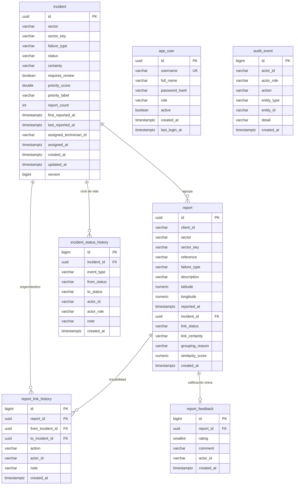

# Ficha técnica del equipo — Luz del Sur

- Fecha de relevamiento: 2026-11-17
- Backend: `luzdelsur-incidencias-back`, rama `develop` (`2eba388`), solo lectura.
- Frontend: `LuzDelSur_Frontend`, inspeccionado por ramas remotas con `git show`; árbol de trabajo sin cambios.
- Microservicio de embeddings: `LuzDelSur_Embeddings`, rama `feat/ficha-tecnica`.
- Este documento no reproduce contraseñas, secretos JWT ni valores de `.env`. Solo indica nombres de variables y rutas.

Rutas base usadas en las citas:

- Backend: `luzdelsur-incidencias-back/backend/...`
- Frontend: `LuzDelSur_Frontend@<rama>:src/...`

---

## 1. Endpoints del backend

No hay un `SecurityFilterChain` de Spring Security: la autorización se hace endpoint por endpoint con `AccessControl.require(...)` (`backend/src/main/java/pe/edu/upc/luzdelsur/incidencias/security/AccessControl.java`). Si un método no llama a `require`, queda abierto. La identidad se toma del JWT (`JwtActorProvider`); sin token, el actor es `anonimo` con rol `CLIENTE` (`JwtActorProvider.java:69`).

### 1.1 Autenticación — `/api/v1/auth`

Fuente: `backend/src/main/java/pe/edu/upc/luzdelsur/incidencias/auth/AuthController.java`

| Método | Ruta | Rol permitido | Qué hace |
| --- | --- | --- | --- |
| POST | `/api/v1/auth/register` | Público | Crea cuenta y devuelve sesión. Por defecto `CLIENTE`; `SISTEMA` prohibido; operador/técnico solo si `APP_AUTH_ALLOW_STAFF_REGISTRATION=true` (`AuthService.java:50-66`). |
| POST | `/api/v1/auth/login` | Público | Valida usuario/contraseña y, si se envía `role`, exige que coincida con el de la cuenta; devuelve access + refresh (`AuthService.java:68-94`). |
| POST | `/api/v1/auth/refresh` | Público con refresh token | Relee la cuenta y su rol desde la base, valida que siga activa y emite tokens nuevos (`AuthService.java:96-103`). |
| GET | `/api/v1/auth/me` | Autenticado (cualquier rol) | Devuelve id, nombre, usuario y rol de la sesión; sin JWT responde 401 (`AuthService.java:105-111`). |

### 1.2 Reportes del cliente — `/api/v1/reports`

Fuente: `backend/src/main/java/pe/edu/upc/luzdelsur/incidencias/api/ReportController.java`

| Método | Ruta | Rol permitido | Qué hace |
| --- | --- | --- | --- |
| POST | `/api/v1/reports` | Sin restricción de rol; admite anónimo | Registra el reporte, ejecuta el motor de agrupación y crea o vincula la incidencia. Si hay JWT, `client_id` = id del actor; si no, usa el `clientId` del cuerpo (`ReportService.java:229-234`). |
| GET | `/api/v1/reports/{reportId}` | Sin restricción de rol; admite anónimo | Devuelve el estado comprensible del reporte para seguimiento (`ReportService.java:124-131`). |
| GET | `/api/v1/reports/mine` | Autenticado no anónimo (cualquier rol) | Lista los reportes cuyo `client_id` coincide con el actor (`ReportService.java:141-158`). |
| POST | `/api/v1/reports/{reportId}/persistence` | Sin `require` de rol ni verificación de propiedad | Si el caso está `RESUELTA` o `CERRADA`, lo pasa a `REABIERTA` y registra el evento; si está `DESCARTADA`, responde 409 (`IncidentService.java:344-371`). |
| POST | `/api/v1/reports/{reportId}/feedback` | Autenticado y dueño del reporte | Califica de 1 a 5 una sola vez, solo si el caso está `RESUELTA` o `CERRADA` (`ReportService.java:160-186`). |

> Hallazgo: `GET /reports/{id}` y `POST /reports/{id}/persistence` no validan que el solicitante sea el dueño. El UUID del reporte funciona como capacidad. La calificación sí valida propiedad.

### 1.3 Motor de agrupación — `/api/v1/grouping`

Fuente: `backend/src/main/java/pe/edu/upc/luzdelsur/incidencias/api/GroupingController.java`

| Método | Ruta | Rol permitido | Qué hace |
| --- | --- | --- | --- |
| GET | `/api/v1/grouping/config` | Público | Devuelve ventana, máximo de candidatos, si embeddings está habilitado/disponible y los umbrales `0.55`/`0.30`. |
| POST | `/api/v1/grouping/preview` | `OPERADOR` | Evalúa un reporte sin persistirlo y devuelve decisión, certeza, revisión, coincidencias y similitud. |

### 1.4 Operador — `/api/v1/operator`

Fuente: `OperatorController.java` y `StaffController.java` (ambos bajo el mismo prefijo).

| Método | Ruta | Rol permitido | Qué hace |
| --- | --- | --- | --- |
| GET | `/api/v1/operator/incidents` | `OPERADOR` | Bandeja priorizada con filtros por estado, certeza, revisión, tipo de falla, sector y `onlyOpen`; ordena por `priorityScore` y antigüedad. |
| GET | `/api/v1/operator/incidents/{incidentId}` | `OPERADOR` | Detalle del caso: incidencia, reportes, historial de vínculos, alertas e historial de estados. |
| POST | `/api/v1/operator/incidents/{incidentId}/confirm` | `OPERADOR` | Confirma la agrupación y pasa el caso a `CONFIRMADA`. |
| POST | `/api/v1/operator/incidents/{incidentId}/status` | `OPERADOR` | Cambia el estado validando la máquina de estados. |
| POST | `/api/v1/operator/incidents/{incidentId}/assign` | `OPERADOR` | Asigna el caso a un técnico activo con rol `TECNICO`. |
| GET | `/api/v1/operator/metrics` | `OPERADOR` | Indicadores de monitoreo: estados, prioridades, sectores y tiempos. |
| POST | `/api/v1/operator/reports/{reportId}/separate` | `OPERADOR` | Separa un reporte del caso, conservando su UUID e historial; por defecto crea un caso nuevo. |
| POST | `/api/v1/operator/reports/{reportId}/reassign` | `OPERADOR` | Reasigna un reporte a otra incidencia abierta. |
| GET | `/api/v1/operator/reports` | `OPERADOR` | Bandeja alternativa de reportes individuales con filtros por incidencia, vínculo, tipo, sector y fechas. |
| GET | `/api/v1/operator/technicians` | `OPERADOR` | Lista técnicos con su carga de casos abiertos. |
| POST | `/api/v1/operator/technicians` | `OPERADOR` | Crea una cuenta de técnico. |
| PATCH | `/api/v1/operator/technicians/{technicianId}` | `OPERADOR` | Activa o desactiva un técnico. |
| GET | `/api/v1/operator/audit-events` | `OPERADOR` | Consulta eventos de auditoría con filtros por actor, acción, entidad y fechas. |

### 1.5 Técnico — `/api/v1/technician`

Fuente: `backend/src/main/java/pe/edu/upc/luzdelsur/incidencias/api/TechnicianController.java`

| Método | Ruta | Rol permitido | Qué hace |
| --- | --- | --- | --- |
| GET | `/api/v1/technician/incidents` | `TECNICO` | Casos `CONFIRMADA`, `EN_ATENCION` o `REABIERTA`; filtros por estado, sector y `onlyMine`. |
| GET | `/api/v1/technician/incidents/history` | `TECNICO` | Casos `RESUELTA` o `CERRADA`; filtros por sector y `onlyMine`. |
| GET | `/api/v1/technician/incidents/{incidentId}/timeline` | `TECNICO` | Historial de vínculos y eventos de estado con notas. |
| GET | `/api/v1/technician/incidents/{incidentId}` | `TECNICO` | Ubicación, alcance estimado y reportes vinculados del caso confirmado. |
| POST | `/api/v1/technician/incidents/{incidentId}/status` | `TECNICO` | Solo permite `EN_ATENCION` o `RESUELTA`; al iniciar atención, el caso se autoasigna al técnico (`IncidentService.java:179-182`). |

### 1.6 Actuator

Fuente: `backend/src/main/resources/application.yml:41-50`

- Se exponen solo `health` e `info`.
- `health` tiene probes habilitados; el compose usa `/actuator/health/readiness`.
- No hay autenticación de Spring Security sobre Actuator; en despliegue, Nginx bloquea `/actuator` y publica solo `/health` (`deploy/nginx/templates/default.conf.template:50-59`).

---

## 2. Autenticación

| Aspecto | Implementación | Fuente |
| --- | --- | --- |
| Hash de contraseñas | BCrypt (`BCryptPasswordEncoder`) | `auth/PasswordConfig.java:11-14` |
| Algoritmo JWT | HS256 (HMAC con `Keys.hmacShaKeyFor`) | `auth/JwtService.java:28`, `:115-128` |
| Emisor | `luzdelsur-incidencias` por defecto | `application.yml:82` |
| Access token | `sub` = UUID del usuario, `role`, `name`, `typ=access`; TTL 60 min por defecto | `JwtService.java:27-33`, `application.yml:83` |
| Refresh token | `sub` + `typ=refresh`; TTL 7 días por defecto; el rol se relee de la base | `JwtService.java:32-33`, `application.yml:84` |
| Secreto | `APP_JWT_SECRET`, mínimo 32 caracteres; si está vacío se genera uno aleatorio por arranque | `JwtService.java:148-151`, `application.yml:79-81` |
| Validación | Firma, emisor, tipo (`access`/`refresh`) y vencimiento; token inválido responde 401 | `JwtService.java:115-140` |
| Registro de personal | Público solo crea `CLIENTE`; operador/técnico los crea un operador o se habilitan con `APP_AUTH_ALLOW_STAFF_REGISTRATION` | `AuthService.java:50-60`, `application.yml:85-87` |
| Revocación | No encontrada: los refresh tokens son JWT sin almacén ni lista de revocación en las migraciones | Búsqueda en `db/migration` y `auth/` |

Roles definidos (`security/ActorRole.java`):

- `CLIENTE`
- `OPERADOR`
- `TECNICO`
- `SISTEMA` (uso interno; no se puede registrar)

Contraseña: el registro exige entre 6 y 72 caracteres (`auth/AuthDtos.java`, `RegisterRequest`). No hay política adicional de complejidad en el código revisado.

---

## 3. Base de datos y relaciones

Fuente: `backend/src/main/resources/db/migration/V1__baseline.sql` a `V5__report_feedback.sql`. Flyway está habilitado y Hibernate usa `ddl-auto: validate` (`application.yml:22-31`).

### 3.1 Tablas y columnas clave

**`incident`** — incidencia padre (V1 + V2)

- `id` UUID PK
- `sector`, `sector_key`, `failure_type`
- `status`, `certainty`, `requires_review`
- `priority_score`, `priority_label`, `report_count`
- `first_reported_at`, `last_reported_at`
- `status_updated_at`, `status_updated_by`
- `confirmed_at`, `confirmed_by`, `closed_at`
- `assigned_technician_id`, `assigned_at` (V2)
- `created_at`, `updated_at`, `version`

**`report`** — reporte original del cliente (V1)

- `id` UUID PK
- `client_id`
- `sector`, `sector_key`, `reference`
- `failure_type`, `description`
- `latitude`, `longitude`, `reported_at`
- `incident_id` UUID FK → `incident.id`
- `link_status`, `link_certainty`, `grouping_reason`
- `similarity_score` (`NUMERIC(4,3)`)
- `link_updated_at`, `link_updated_by`
- `created_at`

**`report_link_history`** — trazabilidad de vínculos (V1)

- `id` BIGINT PK
- `report_id` UUID FK → `report.id`
- `from_incident_id` UUID FK → `incident.id` (nullable)
- `to_incident_id` UUID FK → `incident.id` (nullable)
- `action`, `actor_id`, `note`, `created_at`

**`app_user`** — cuentas (V3)

- `id` UUID PK
- `username` (único)
- `full_name`
- `password_hash` (BCrypt)
- `role`, `active`
- `created_at`, `last_login_at`

**`incident_status_history`** — ciclo de vida del caso (V4)

- `id` BIGINT PK
- `incident_id` UUID FK → `incident.id`
- `event_type`
- `from_status`, `to_status`
- `actor_id`, `actor_role`, `note`
- `created_at`

**`audit_event`** — auditoría transversal (V4)

- `id` BIGINT PK
- `actor_id`, `actor_role`
- `action`
- `entity_type`, `entity_id`
- `detail`
- `created_at`

**`report_feedback`** — calificación del cliente (V5)

- `id` BIGINT PK
- `report_id` UUID FK → `report.id`, único
- `rating` SMALLINT con `CHECK (rating BETWEEN 1 AND 5)`
- `comment`, `actor_id`, `created_at`

### 3.2 Diagrama entidad-relación

Notas de integridad:

- `report.client_id`, `incident.assigned_technician_id` y los `actor_id` son `VARCHAR(64)`, **no** tienen FK a `app_user.id`.
- `report_feedback.report_id` tiene índice único: una calificación por reporte.
- `audit_event` no tiene FK; es una tabla independiente.

---

## 4. Auditoría

Fuente: `backend/src/main/java/pe/edu/upc/luzdelsur/incidencias/audit/` y `V4__audit_and_status_history.sql`.

- Tabla principal: `audit_event`, con `actor_id`, `actor_role`, `action`, `entity_type`, `entity_id`, `detail` y `created_at`.
- Se escribe en transacción propia (`REQUIRES_NEW`) para que un login fallido también quede registrado y para que un fallo de auditoría no revierta la operación (`AuditService.java:29-44`).
- Acciones registradas (`AuditAction.java`):

| Acción | Origen |
| --- | --- |
| `REGISTRO` | Registro de cuenta |
| `LOGIN_OK` | Login exitoso |
| `LOGIN_FALLIDO` | Credenciales inválidas, cuenta desactivada o rol incorrecto |
| `TOKEN_REFRESCADO` | Renovación de tokens |
| `REPORTE_CREADO` | Alta de reporte |
| `PERSISTENCIA_REPORTADA` | Cliente indica que la falla persiste |
| `CALIFICACION_REGISTRADA` | Feedback del cliente |
| `AGRUPACION_CONFIRMADA` | Operador confirma agrupación |
| `ESTADO_CAMBIADO` | Cambio de estado por operador o técnico |
| `REPORTE_SEPARADO` | Operador separa un reporte |
| `REPORTE_REASIGNADO` | Operador reasigna un reporte |
| `TECNICO_ASIGNADO` | Operador asigna técnico |
| `USUARIO_CREADO` | Operador crea técnico |
| `USUARIO_ACTUALIZADO` | Operador activa/desactiva técnico |

- Además existen dos bitácoras de negocio distintas de `audit_event`:
  - `report_link_history`: vínculos, separaciones, reasignaciones y reaperturas por reporte.
  - `incident_status_history`: cambios de estado y asignaciones del caso, con actor y nota.
- El detalle de auditoría no almacena contraseñas ni descripciones de reportes (comentario en `V4`).

---

## 5. HTTPS

- El backend **no configura TLS**. No hay `server.ssl.*`, keystore ni truststore en `backend/src/main/resources` ni en `application.yml`.
- `server.forward-headers-strategy: framework` está activo (`application.yml:5`), para respetar `X-Forwarded-*` detrás de un proxy.
- El despliegue incluye un proxy Nginx con TLS (`deploy/docker-compose.yml:103-115` y `deploy/nginx/templates/default.conf.template`):
  - HTTP `80` redirige a HTTPS y expone el reto ACME.
  - HTTPS `443` con TLS 1.2/1.3, HSTS y certificados montados desde `deploy/certs`.
  - El backend solo se expone dentro de la red Docker (`expose: 8080`), no publica puerto al host.
- Conclusión: HTTPS se asume en un proxy externo (Nginx incluido en el compose). El backend por sí solo escucha HTTP en `8080`.

---

## 6. Pruebas automáticas del backend

- Cantidad: **25 métodos `@Test`** en **6 clases** (`backend/src/test/...`).
- El documento `docs/pruebas-backend.md` registra una ejecución anterior con 21 pruebas; quedó desactualizado respecto al código actual.
- **No se pudieron ejecutar en esta sesión**: el repositorio no incluye `mvnw`/`mvnw.cmd` y no hay Maven instalado en el equipo (solo hay JDK 21). El comando documentado en `docs/pruebas-backend.md` (`./mvnw test`) no es reproducible tal cual con este clon.

| Clase | `@Test` | Qué cubre |
| --- | ---: | --- |
| `GroupingEngineTest` | 7 | C1, C2, C3/C4, C5, similitud baja y embeddings caídos. |
| `ReportFlowIntegrationTest` | 9 | Flujo completo, C2–C5, validaciones, salud, privacidad de reportes propios y bandeja/asignación del técnico. |
| `AuthFlowIntegrationTest` | 3 | Registro/login/me/refresh, cabeceras de desarrollo ignoradas en modo estricto y flujo completo con JWT. |
| `HttpDescriptionSimilarityClientTest` | 4 | Contrato HTTP, campos `snake_case`, filtrado de valores y enfriamiento ante fallos. |
| `DemoDataSeederTest` | 1 | Creación de cuentas y dataset demo. |
| `SchemaValidationTest` | 1 | Flyway + mapeo JPA con `ddl-auto=validate`. |

Las pruebas usan H2 en modo compatible (`backend/pom.xml`) y no hay Testcontainers en el POM. No se encontraron pruebas de frontend (no hay Vitest/Jest en `package.json`).

---

## 7. Cuentas demo

Fuente: `backend/src/main/java/pe/edu/upc/luzdelsur/incidencias/config/DemoDataSeeder.java:42-45,78-81`.

| Usuario | Rol |
| --- | --- |
| `operador@luzdelsur.com.pe` | `OPERADOR` |
| `tecnico@luzdelsur.com.pe` | `TECNICO` |
| `tecnico2@luzdelsur.com.pe` | `TECNICO` |
| `cliente@luzdelsur.com.pe` | `CLIENTE` |

- La contraseña no se reproduce. Se toma de `APP_DEMO_PASSWORD` (`DemoDataSeeder.java:95`); `application.yml:88-92` define un valor por defecto estático y siembra usuarios/reportes activada por defecto (`APP_DEMO_SEED_USERS`, `APP_DEMO_SEED_REPORTS`).
- Los reportes demo solo se cargan si la tabla `report` está vacía (`DemoDataSeeder.java:85`).
- Antes de producción hay que cambiar la contraseña demo y desactivar la siembra. También hay que definir `APP_JWT_SECRET`.

---

## 8. Frontend: ramas, rutas y pantallas

### 8.1 Ramas revisadas

| Rama remota | Último commit | Contenido |
| --- | --- | --- |
| `origin/main` | `5792a21` (2026-11-10) | Solo `README.md`; no hay código de aplicación. |
| `origin/dev` | `b0a3c07` (2026-11-16) | Cliente + operador + técnico, sin la integración JWT final. Envía `X-Actor-*` y guarda UUID de reportes en `localStorage`. |
| `origin/develop` | `33a96a3` (2026-11-16) | Merge de `feature/integracion-backend`; es la rama más completa: JWT, refresh, `/reports/mine`, feedback y asignación de técnico. |
| `origin/feature/integracion-backend` | `d88edfd` (2026-11-16) | Misma base que `develop`, antes del merge. |
| `origin/feature/vistas-cliente` | `2307eb5` (2026-11-15) | Vistas de cliente y operador; sin técnico ni integración JWT final. |
| `origin/feat/vistas-tecnico` | `177ce1d` (2026-11-15) | Vistas de técnico; sin cliente ni operador. |

La descripción de pantallas siguiente usa `origin/develop`, por ser la rama más completa.

### 8.2 Rutas y pantallas por rol

Fuente: `LuzDelSur_Frontend@origin/develop:src/app/router.tsx`.

| Ruta | Rol | Pantalla y contenido |
| --- | --- | --- |
| `/login` | Público | Inicio de sesión con selector de rol (`TECNICO`, `OPERADOR`, `CLIENTE`), usuario y contraseña. Llama a `POST /auth/login`. |
| `/register` | Público | Registro de cuenta de cliente; avisa que operador/técnico los habilita un operador. Llama a `POST /auth/register`. |
| `/cliente/panel` | `CLIENTE` | Panel del Cliente: resumen de sus reportes por estado (revisión, en curso, cerradas), accesos a nueva incidencia y seguimiento. Usa `GET /reports/mine`. |
| `/cliente/nueva` | `CLIENTE` | Formulario de nueva incidencia: sector, tipo de falla, descripción, referencia y coordenadas. Llama a `POST /reports`. |
| `/cliente/reportes` | `CLIENTE` | “Mis Reportes”: listado de reportes propios con estado y acceso al detalle. Usa `GET /reports/mine`. |
| `/cliente/reportes/:reportId` | `CLIENTE` | Seguimiento del reporte: estado, mensaje del backend, historial, botón de persistencia si está `RESUELTA`/`CERRADA` y tarjeta de calificación. Usa `GET /reports/{id}`, `POST /persistence` y `POST /feedback`. |
| `/operador/bandeja` | `OPERADOR` | Bandeja de Gestión: incidencias priorizadas, filtros por estado/certeza/revisión/tipo/sector, paginación y refresco automático cada 30 s. Usa `GET /operator/incidents`. |
| `/operador/incidencias/:incidentId` | `OPERADOR` | Detalle del caso: datos de la incidencia, reportes vinculados con certeza y similitud, historial de vínculos y de estados, alertas. Acciones: confirmar agrupación, asignar técnico, cerrar caso, separar y reasignar reportes. |
| `/tecnico/tareas` | `TECNICO` | Tareas del técnico: casos confirmados/en atención/reabiertos, botón “Iniciar Atención” (`EN_ATENCION`) y “Resolver” (`RESUELTA`), y detalle consolidado. Usa `GET /technician/incidents` y `POST /technician/incidents/{id}/status`. |
| `/tecnico/historial` | `TECNICO` | Historial de tareas cumplidas (`RESUELTA`/`CERRADA`) con línea de tiempo y detalle de auditoría del caso. Usa `GET /technician/incidents/history` y `/timeline`. |
| `/` y `*` | — | Redirige al inicio correspondiente al rol autenticado, o a `/login`. |

Protección de rutas: `src/app/ProtectedRoute.tsx` compara `user.role` con `allowedRoles` y redirige al home del rol si no coincide. El menú y los layouts por rol están en `src/shared/layouts/`.

### 8.3 ¿Se ven similitud y certeza en la bandeja del operador?

- **Certeza (`ALTA`/`MEDIA`/`BAJA`)**: sí. La bandeja muestra un `StatusBadge` de certeza y una marca de “REVISIÓN”/“Baja certeza” cuando `requiresReview` es verdadero (`OperatorInboxPage.tsx`, columnas “Certeza” y vista móvil). También se puede filtrar por `certainty` y `requiresReview`.
- **Similitud numérica**: no en la bandeja. `SimilarityIndicator` no se usa en `OperatorInboxPage.tsx`; se usa en el detalle del caso, por cada reporte (`OperatorIncidentDetailPage.tsx:516,611`). Si el backend no devuelve valor, muestra “No disponible”.
- La bandeja **no** muestra el motivo textual de agrupación ni el `grouping_reason`; solo certeza, revisión y prioridad.

### 8.4 Datos reales vs. datos falsos

- No se encontraron mocks, `fake` ni fallbacks con datos inventados en `origin/develop`: los servicios `customer.service.ts`, `operator.service.ts`, `technician.service.ts` y `auth.service.ts` llaman directamente a la API y propagan los errores.
- `origin/dev` guarda en `localStorage` solo los **UUID** de reportes creados desde el navegador (`myReports.registry.ts`) porque esa rama aún no usaba `GET /reports/mine`. No son datos de negocio falsos: el estado siempre se consulta al backend.
- Las cuentas y los 15 reportes demo son datos sembrados por el backend (`DemoDataSeeder`), no datos de producción. El frontend los muestra como cualquier dato real de la API.
- El formulario de login de `origin/develop` trae credenciales demo precargadas en el código (usuario y contraseña). No se reproducen aquí; es un riesgo para producción.

### 8.5 Variable de entorno y despliegue

- URL de la API: `VITE_API_URL`. Ejemplo versionado en `LuzDelSur_Frontend@origin/develop:.env.example` (`VITE_API_URL=http://localhost:8080/api`).
- Cliente HTTP: `src/shared/services/api.ts` usa `import.meta.env.VITE_API_URL || 'http://localhost:8080/api'` y añade `Authorization: Bearer <token>`; renueva el access token con `POST /v1/auth/refresh`.
- Vercel: el `README.md` de `origin/develop` menciona Vercel como plataforma de despliegue y un badge, pero **no se encontró `vercel.json`** ni configuración equivalente en ninguna de las ramas revisadas. Tampoco hay `Dockerfile`, `netlify.toml` ni workflows de CI/CD.
- Build: `npm run build` (`tsc -b && vite build`). En Vercel habría que definir `VITE_API_URL` en el panel del proyecto; no hay configuración versionada que lo haga.

---

## 9. Estado del flujo de punta a punta

| Paso | Estado | Evidencia |
| --- | --- | --- |
| Reportar | Completo | `POST /reports` + formulario `NewReportForm`; guarda reporte y ejecuta agrupación. |
| Agrupar | Completo, con similitud auxiliar | `GroupingEngine`/`GroupingService`; reglas por sector, ventana de 30 min y tipo; la similitud solo ajusta certeza. |
| Confirmar | Completo | `POST /operator/incidents/{id}/confirm` + `ConfirmGroupingModal`; pasa a `CONFIRMADA`. |
| Asignar | Completo | `POST /operator/incidents/{id}/assign` + `AssignTechnicianModal`; también autoasignación al iniciar atención. |
| Resolver | Completo | Técnico: `EN_ATENCION` → `RESUELTA`; operador: `RESUELTA` → `CERRADA`. |
| Calificar | Completo | `POST /reports/{id}/feedback` + `RateServiceCard`, solo dueño, una vez, con caso `RESUELTA`/`CERRADA`. |
| Reabrir si persiste | Completo en backend y frontend | `POST /reports/{id}/persistence` + botón en seguimiento; pasa a `REABIERTA`. |

### 9.1 Brechas y observaciones

1. **Persistencia sin control de propiedad**: `markPersistence` no verifica rol ni dueño; cualquier solicitante con el UUID puede reabrir un caso. En cambio, la calificación sí valida dueño.
2. **Seguimiento público por UUID**: `GET /reports/{id}` no exige autenticación. Es una decisión de prototipo, pero conviene documentarla o protegerla.
3. **Sin revocación de refresh tokens**: no hay tabla de sesiones, lista negra ni rotación obligatoria; un refresh token robado vale hasta 7 días.
4. **Auditoría sin pantalla**: el backend expone `GET /operator/audit-events`, pero el router del frontend no tiene ruta de auditoría.
5. **Funciones de backend sin UI**: métricas (`/operator/metrics`), reportes individuales (`/operator/reports`), configuración/preview del motor (`/grouping/*`) y gestión de técnicos (`POST/PATCH /operator/technicians`) no aparecen en el router del frontend.
6. **Cierre manual**: no hay cierre automático; un operador debe pasar el caso de `RESUELTA` a `CERRADA`.
7. **Autorización manual**: al no haber `SecurityFilterChain`, cualquier endpoint nuevo que olvide `accessControl.require(...)` queda expuesto. Hoy el caso más visible es `/persistence`.
8. **Datos demo activos por defecto**: `APP_DEMO_SEED_USERS` y `APP_DEMO_SEED_REPORTS` vienen en `true`, y la contraseña demo tiene valor por defecto en `application.yml`. Deben cambiarse en producción.
9. **JWT sin secreto fijo**: si `APP_JWT_SECRET` queda vacío, cada reinicio invalida las sesiones. Debe definirse en el despliegue.
10. **Frontend en Vercel sin configuración versionada**: funciona con la configuración del panel, pero no hay `vercel.json` ni documentación de rewrites para React Router. Sin rewrite a `index.html`, las rutas profundas pueden dar 404 al recargar.

---

## 10. No encontrado / no implementado

- No se encontró configuración TLS dentro del backend (se delega a Nginx).
- No se encontraron pruebas de frontend.
- No se encontró `vercel.json`, `Dockerfile` de frontend, `netlify.toml` ni CI/CD en el frontend.
- No se encontró revocación o almacenamiento de refresh tokens.
- No se encontró pantalla de auditoría, métricas, gestión de técnicos ni configuración del motor en el frontend.
- No se encontró un campo `incidente_esperado` en los datos del backend; las etiquetas de la prueba de semillas se derivaron de comentarios del `DemoDataSeeder` (ver `docs/prueba_semillas.md`).

---

## 11. Archivos de referencia

Backend:

- `backend/src/main/java/pe/edu/upc/luzdelsur/incidencias/api/`
- `backend/src/main/java/pe/edu/upc/luzdelsur/incidencias/auth/`
- `backend/src/main/java/pe/edu/upc/luzdelsur/incidencias/security/`
- `backend/src/main/java/pe/edu/upc/luzdelsur/incidencias/audit/`
- `backend/src/main/java/pe/edu/upc/luzdelsur/incidencias/incident/`
- `backend/src/main/java/pe/edu/upc/luzdelsur/incidencias/report/`
- `backend/src/main/resources/application.yml`
- `backend/src/main/resources/db/migration/V1__baseline.sql` … `V5__report_feedback.sql`
- `backend/src/test/`
- `deploy/docker-compose.yml`, `deploy/nginx/`, `deploy/.env.example`

Frontend (`origin/develop`):

- `src/app/router.tsx`, `src/app/ProtectedRoute.tsx`
- `src/shared/services/api.ts`, `src/shared/services/session.ts`
- `src/features/auth/`, `src/features/customer/`, `src/features/operator/`, `src/features/technician/`
- `.env.example`, `README.md`
